# Loop / Graph 設計

圖中**方形**是生成節點，**菱形**是檢查節點，綠色是需要使用者確認的節點。紅框的「② 先討論」是實際跑過一次之後，把檢查往前移所改出來的節點（見[反思](reflection.md)）。流程圖原始碼：[`assets/workflow.mmd`](assets/workflow.mmd)。

## 流程一句話版

取得資料 → 先討論 → 寫入 Wiki → 自動 Lint → 人工 Lint →（每篇重複）→ 查詢 Wiki 產生大綱 → 大綱檢查 → 生成投影片 → 事實回溯檢查 → 渲染檢查 → 發佈

## 資訊怎麼流動

| 階段 | 取得 | 整理 | 檢查 | 產出 |
|---|---|---|---|---|
| Wiki | 讀論文全文（不只摘要）；拿不到就請使用者提供 | 依 `AGENTS.md` 的格式寫成來源頁與概念頁，每句事實標來源 ID | `tools/lint.py`＋人工 | `docs/wiki/` |
| 簡報 | 只從 Wiki 查詢，**不回頭讀原始論文** | 大綱每張標註 `data-wiki`（依據頁）與 `data-src`（來源 ID） | `tools/check_slides.py`、`tools/check_render.py`＋人工 | `docs/slides/index.html` |

「簡報只能從 Wiki 取材」是整個設計的核心：Wiki 是唯一經過檢查的知識層，投影片上的每個數字都能被程式回溯到某個 Wiki 頁面。

## 哪些步驟會重複執行？

- **① 到 ⑤ 每篇來源跑一次**：本次共 6 篇（S1、S2、S3、S4、S5、S7），S6 經討論後不納入。
- **③ ↔ ④⑤ 會在同一篇內來回**：Lint 不通過就回去改 Wiki，直到通過。
- **⑧ ↔ ⑨⑩ 會來回**：事實或版面檢查不通過就重新生成投影片。
- **檢查工具本身也會重複修改**：每改一次 lint 或檢查腳本，就故意放入錯誤，確認它還抓得到（圖中右側節點）。

## 哪些地方需要檢查或重新生成？

| 檢查節點 | 檢查什麼 | 不通過時 |
|---|---|---|
| ② 先討論 | 重點是否正確、要建哪些頁、新術語、**和既有來源有沒有矛盾** | 修正後再確認；發現缺口就回 ① 找新來源 |
| ④ 自動 Lint | 事實句有沒有來源 ID、來源 ID 是否存在、斷連結、孤兒頁、frontmatter | 回 ③ 改內容；若是 lint 誤報，修 lint 並自我驗證 |
| ⑤ 人工 Lint | 術語有沒有白話解釋、來源間矛盾 | 回 ③ 補說明 |
| ⑦ 大綱檢查 | 每張投影片都有 Wiki 依據、使用者同意 | Wiki 缺依據就回 ③；否則調整大綱 |
| ⑨ 事實回溯 | 自動：每個數字都能在標註的 Wiki 頁找到、來源 ID 一致；人工：敘述是否忠於 Wiki、💡 詮釋有沒有被寫成事實 | 回 ⑧ 重新生成；Wiki 沒有的事實回 ③ |
| ⑩ 渲染 | 內容溢出、壓到頁尾、公式是否渲染、4 種螢幕尺寸；再看截圖 | 回 ⑧ 修版面 |

## 為什麼這樣設計？

1. **先討論、後生成**：作業要求，也最省事。在寫入前就讓人確認重點和範圍，比寫完再大改便宜；S1 的公式缺口、S3 的雜訊矛盾、S5 的論文內部不一致，都是在討論時抓到的。
2. **Wiki 當唯一知識層**：簡報不直接讀論文，所以只要 Wiki 對，簡報的錯誤就只剩「轉述錯」與「版面錯」兩種，檢查範圍變小、變得可以自動化。
3. **每句標來源 ID**：讓「這句話從哪來」可以被程式檢查，而不是靠感覺。
4. **自動＋人工並存**：自動檢查抓得到格式、數字、版面；但「術語沒解釋」「詮釋被當成事實」這類語意問題，這次每一輪都要靠人工才抓得到。
5. **檢查工具也要被檢查**：這次 lint 出現過誤報、事實檢查太鬆、渲染檢查漏測手機，三者都是檢查工具本身的錯。所以每次修改都用「故意放錯」驗證。
